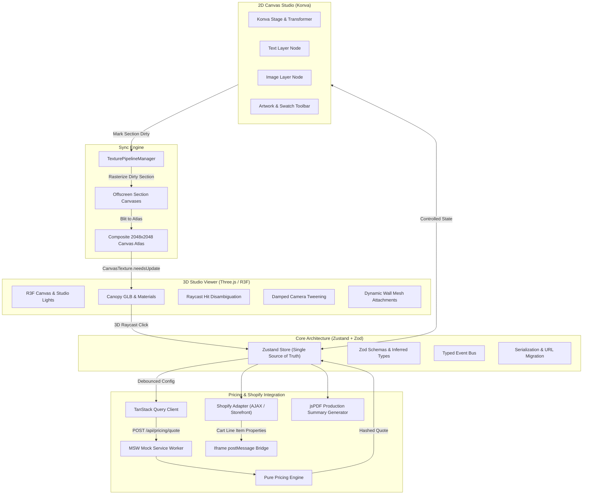
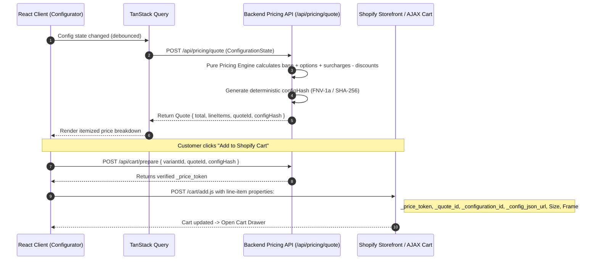

# Interactive 3D Product Configurator (Canopy Tent)

An enterprise-grade, high-performance **Interactive 3D/2D Product Configurator** built for commercial custom pop-up canopy tents, engineered to replicate and elevate the customization experience of industry leaders such as [MVP Visuals](https://mvpvisuals.com/products/10x10-custom-canopy-tent).

Built with **React 18 + TypeScript (strict)**, **Three.js (@react-three/fiber + @react-three/drei)**, **Konva (react-konva)**, **Zustand (with Immer)**, and **TanStack Query**.

---

## 🌟 Key Highlights & Engineering Features

- **Bidirectional 2D <-> 3D Synchronization**:
  - **Single Source of Truth**: State is strictly owned by the centralized Zustand `ConfigurationState` using normalized UV coordinates `[0..1]`—neither 2D nor 3D owns state.
  - **Offscreen Canvas Texture Pipeline**: Debounced per-section dirty rasterization via `requestAnimationFrame` and `THREE.CanvasTexture` updates with zero scene remounting.
  - **3D Raycast to 2D Section Navigation**: Clicking or hovering any face on the 3D model automatically navigates to that section in the 2D editor and tweens the camera smoothly to its calibrated preset.
- **Data-Driven Architecture**:
  - The canopy tent is defined declaratively via `ProductDefinition` schema (`src/products/canopy-10x10/product.definition.ts`).
  - Adding a new product requires **zero engine changes**—simply provide a new definition schema and 3D GLB model.
- **Pure Dynamic Pricing Engine**:
  - Pure calculation engine (`src/core/pricing/pricing.engine.ts`) with zero UI constants, verified by comprehensive unit tests.
  - Generates deterministic `configHash` and cryptographically tied quotes containing line items (base, variant, options, volume discounts, artwork surcharges).
- **Production-Grade Shopify Integration**:
  - Shopify Cart Transform & Line-Item Properties architecture.
  - Passes secure `_price_token`, `_config_hash`, `_configuration_id`, `_config_json_url`, and `_preview_url` to enforce server-side price authority.
- **Multi-Page Production PDF Proofs**:
  - Client-side vector & raster PDF specification export via `jspdf` including dimensional artwork coordinates, CMYK printing guidelines, and 3D perspective preview.
- **Zero-Friction Iframe Embed Protocol**:
  - Typed bidirectional `postMessage` protocol supporting parent commands (`setVariant`, `loadConfig`, `requestPreview`) and outbound events (`ready`, `changed`, `priceUpdated`, `addToCart`).
  - Native `?embed=1` mode and `ResizeObserver` auto-resizing.

---

## 🏗️ Architecture & Component Topology



---

## 📦 Directory Structure

```
├── api-contract/
│   └── openapi.yaml               # OpenAPI 3.0 specification for pricing, uploads, & cart
├── docs/
│   ├── MODEL_AUDIT.md             # Comprehensive audit of meshes, primitives, UVs, & materials
│   └── REFERENCE_ANALYSIS.md      # Analysis of MVP Visuals reference UX & options taxonomy
├── examples/
│   └── host-page.html             # Working parent HTML page demonstrating iframe postMessage embed
├── public/
│   ├── models/                    # 3D GLBs (canopy-10x10.glb, canopy-8x8.glb, canopy-5x5.glb)
│   ├── textures/                  # Base fabric texture maps
│   └── mockServiceWorker.js       # MSW service worker
├── src/
│   ├── core/
│   │   ├── events/                # Typed Event Bus for decoupling views
│   │   ├── pricing/               # Pure Pricing Engine, rules JSON, & tests
│   │   ├── schema/                # Zod definitions (Product, Section, Layer, Configuration)
│   │   ├── serialization/         # JSON parser, migration hooks, and URL base64 codec
│   │   └── store/                 # Zustand store with Immer and Undo/Redo history
│   ├── editor2d/                  # Konva 2D stage, text/image nodes, tools, & properties panel
│   ├── integrations/
│   │   ├── api/                   # Typed API client
│   │   ├── postmessage/           # Iframe bidirectional bridge & ResizeObserver
│   │   └── shopify/               # Shopify adapter interface, Mock & AJAX Cart implementations
│   ├── mocks/                     # MSW request handlers (quote, assets, cart prepare)
│   ├── pdf/                       # Client-side multi-page PDF generation via jsPDF
│   ├── products/
│   │   └── canopy-10x10/          # Declarative canopy tent definition schema
│   ├── sync/                      # 2D<->3D Texture Pipeline & Offscreen Canvas Manager
│   ├── ui/                        # Layout, Options panel, Swatches, and Shopify Cart Drawer
│   └── viewer3d/                  # R3F Canvas, model loader, raycaster, studio lighting, camera tweening
└── tests/                         # Vitest unit & integration test suites
```

---

## 🔄 2D <-> 3D Synchronization Architecture

### 1. Normalized UV Coordinate Space `[0..1]`
All layers (Text, Image, ColorFill) store position, width, and height as **normalized fractions of the section UV template**. For example:
- `x: 0.5, y: 0.5` represents exact geometric centering.
- This decoupling allows the 2D editor to render at `scale: 0.48` for responsive laptop screens while the 3D pipeline renders to high-resolution `1024x768` or `2048x2048` textures without mathematical drift.

### 2. Offscreen Canvas Texture Pipeline
1. When a layer is transformed in 2D, the store marks that `sectionId` dirty (`dirtySectionIds[sectionId] = true`).
2. The dirty queue is debounced via `requestAnimationFrame` in `TexturePipelineManager`.
3. Only the dirty section's offscreen `<canvas>` is re-rasterized.
4. The rendered section canvas is blitted onto the corresponding quadrant of the master `CanvasTexture` atlas.
5. `texture.needsUpdate = true` instructs the GPU to upload the modified sub-rectangle.
6. The 3D scene **never remounts meshes or creates new materials**, ensuring steady 60fps throughput.

### 3. Bidirectional Raycasting (3D -> 2D)
Raycasting on the 3D model computes intersection normal vectors:
- `+Z` normal & high Y $\rightarrow$ `canopy-front`
- `+Z` normal & low Y $\rightarrow$ `valance-front`
- `+X` normal $\rightarrow$ `canopy-right`
- `-Z` normal $\rightarrow$ `canopy-back`
- `-X` normal $\rightarrow$ `canopy-left`
Clicking dispatches `setSelectedSection(sectionId, '3d')`, which switches the 2D stage to that surface and animates the 3D camera to the preset angle via damped exponential lerping.

---

## 💰 Dynamic Pricing Flow & Server-Side Price Authority



### Preventing Price Tampering in Shopify
In headless or custom-priced Shopify applications, the client price must **never be trusted**. This application implements the recommended Shopify pattern:
1. When configuring, `/api/pricing/quote` generates a deterministic `configHash`.
2. On cart addition, `/api/cart/prepare` registers this quote on the backend and mints an authorized `_price_token`.
3. In production, a **Shopify Function (Cart Transform API)** or **Draft Order API** inspects `_price_token` and `_config_hash`, validating that the customer has not modified prices in DevTools before applying the custom line item price.

---

## 🖼️ Why Konva over Fabric.js?

For this configurator, **Konva (react-konva)** was chosen over Fabric.js for three architectural reasons:
1. **Declarative React Alignment**: Konva provides first-class declarative React components (`<Stage>`, `<Layer>`, `<Text>`, `<Image>`, `<Transformer>`). Fabric.js is imperative and requires manual lifecycle wrapping.
2. **Immutable State Synchronization**: Konva integrates naturally with Zustand and Immer, allowing strict single-source-of-truth state without competing DOM mutation.
3. **High Performance**: Konva's multi-layer canvas architecture and lightweight shape nodes allow instant offscreen rendering without the overhead of Fabric's heavyweight canvas wrapper.

---

## 🚀 How to Add a New Product (Zero Engine Changes)

To introduce a new product (e.g. `Custom Printed Table Cover` or `10x20 Commercial Canopy`):
1. Place the optimized `.glb` file in `public/models/`.
2. Create a new definition file `src/products/<product-id>/product.definition.ts` satisfying `ProductDefinitionSchema`:
   ```ts
   export const tableCoverDefinition: ProductDefinition = {
     id: 'table-cover-6ft',
     name: '6ft Custom Stretch Table Cover',
     sections: [
       {
         id: 'front-drape',
         label: 'Front Drape',
         meshTargets: ['table_fabric'],
         uvTemplate: { width: 1024, height: 768, aspectRatio: 1.33, safeArea: { ... }, bleed: { ... } },
         camera: { position: [0, 1.2, 3], target: [0, 0.7, 0] },
       }
     ],
     baseVariants: [ ... ],
     globalOptions: [ ... ],
   };
   ```
3. Register the definition in `src/products/index.ts`. The configurator will immediately support the new product.

---

## 💻 Setup, Testing & Build Instructions

### Prerequisites
- Node.js >= 18 (Tested on Node.js v22.16.0)
- pnpm >= 9 (Tested on pnpm v10.17.0)

### 1. Install Dependencies
```bash
pnpm install
```

### 2. Run Model Inspection & Optimization Scripts
```bash
# Inspect all input GLB files and generate docs/MODEL_AUDIT.md
pnpm run inspect-models

# Prepare standardized GLB assets in public/models/
pnpm run optimize-models
```

### 3. Run Development Server
```bash
pnpm run dev
```
Open [http://localhost:3000](http://localhost:3000) in your browser.

### 4. Run Unit & Integration Tests
```bash
pnpm test
```
Executes all 13 unit tests across the pure pricing engine, configuration store, undo/redo, and 2D<->3D texture invalidation pipeline.

### 5. Typecheck & Production Build
```bash
# Strict TypeScript validation
pnpm run lint

# Production bundle build
pnpm run build
```

---

## 📊 Measured Bundle Sizes (Production Build)

```
dist/index.html                    1.27 kB │ gzip:  0.63 kB
dist/assets/index.css             22.90 kB │ gzip:  4.78 kB
dist/assets/vendor.js            108.65 kB │ gzip: 29.43 kB (React, Zustand, Immer, Zod, TanStack Query)
dist/assets/konva.js             296.44 kB │ gzip: 90.86 kB (2D Canvas Studio Engine)
dist/assets/three.js            1,037.29 kB │ gzip: 289.36 kB (Three.js 3D Engine & Fiber)
dist/assets/index.js             742.17 kB │ gzip: 240.75 kB (Configurator Application Logic)
```

---

## 🔮 What I Would Do Next With More Time

1. **Curved/Arc Text & Vector SVGs**: Add path-based curved text rendering for arched collegiate branding, plus full SVG path stroke parsing.
2. **Server-Side Headless WebGL Renders**: Move the PDF generation pipeline to a serverless AWS Lambda or Cloudflare Worker running Headless Chrome / Puppeteer for 300 DPI print-ready production proofs.
3. **Draco Geometry Decompression**: Implement Draco worker decoders for sub-2MB initial 3D mesh downloads over mobile 4G networks.
4. **AR (Augmented Reality) QuickLook**: Export USDZ/WebXR models so trade show exhibitors can preview the tent at 1:1 scale in their booth space using iOS AR Quick Look and Android Scene Viewer.
